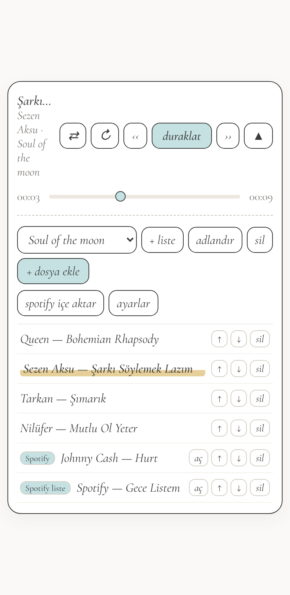

# Soul of the moon

Tek dosyalık, sade ve edebi görünümlü bir web müzik çalar. Kendi müzik dosyalarınızı çalar, Spotify çalma listelerini ekler.

**Canlı sürüm:** https://ezgitspnr.github.io/Soul-of-the-moon-web-playet/



## Özellikler

- **Kendi müzikleriniz:** FLAC, MP3, WAV, OGG, M4A ve AAC dosyaları eklenir ve tarayıcıda saklanır. Sayfayı yenileseniz ya da tarayıcıyı kapatsanız da arşiviniz yerinde kalır; dosyaları yeniden seçmeniz gerekmez. Dosyalar hiçbir yere yüklenmez.
- **Parça başına süre çubuğu:** Çubuk her zaman çalan parçanın kendi süresini gösterir. Parça değişince sıfırlanır; çubuğu sürükleyerek ileri geri sarabilirsiniz.
- **Çalma kontrolleri:** oynat/duraklat, önceki, sonraki, karışık çalma, parçayı tekrarla ve otomatik sonraki parça. "Önceki" parçanın ilk 3 saniyesinden sonra parçayı başa sarar.
- **Çalma listeleri:** oluşturma, yeniden adlandırma, silme, listeler arasında geçiş; parçaları yukarı/aşağı sıralama, başka listeye taşıma ve kaldırma. Bir dosyayı arşivden silmeden önce onay istenir.
- **Spotify çalma listeleri:** bağlantıyı yapıştırın, liste yerel müziklerinizin yanında çalınır. İki yol vardır:
  - **Client ID olmadan:** liste, Spotify'ın gömülü oynatıcısıyla olduğu gibi eklenir.
  - **Client ID ile:** liste Spotify'ın resmî API'siyle parça parça içe aktarılır (OAuth 2.0 PKCE, istemci sırrı gerekmez); parçalar sırasıyla çalar.
- **Karma listeler:** aynı listede yerel dosyalar ve Spotify öğeleri bir arada olabilir. Spotify içe aktarırken aynı öğenin aynı listeye tekrar eklenmesi varsayılan olarak engellenir (ayarlardan açılabilir).
- **Mobil uyumlu**, klavye ile kullanılabilir (listedeki parçada `Enter`), kilit ekranı kontrolleri.

## Kullanım

### Yalnızca kendi müzikleriniz

1. `index.html` dosyasını tarayıcıda açın (çift tıklamak yeterli).
2. Sağ üstteki **▼** düğmesiyle listeyi açın.
3. **+ dosya ekle** ile müzik dosyalarınızı seçin.
4. Bir parçaya tıklayın veya **oynat**'a basın.

Yeni liste için **+ liste**, ad değiştirmek için **adlandır**, listeyi silmek için **sil** düğmesini kullanın. Parçanın yanındaki **↑ ↓** sırayı değiştirir, **taşı** parçayı sıradaki listeye aktarır, **sil** parçayı kaldırır.

### Spotify listesi eklemek

> Spotify özellikleri `file://` ile açılan sayfada çalışmaz. Sayfayı **HTTPS** veya **`http://127.0.0.1`** adresinden açın (aşağıda iki yol var).

1. **▼** ile listeyi açın ve **spotify içe aktar**'a basın.
2. Spotify çalma listesi bağlantısını yapıştırıp **getir**'e basın.
3. Hedef listeyi seçip **ekle**'ye basın.

Client ID girilmediyse liste gömülü oynatıcı olarak eklenir. Tarayıcıda Spotify oturumu açıksa parçalar tam çalar, değilse 30 saniyelik önizleme çalar.

**Parça parça içe aktarmak için (isteğe bağlı):**

1. [Spotify Developer Dashboard](https://developer.spotify.com/dashboard)'da bir uygulama oluşturun.
2. **Redirect URI** olarak sayfanın adresini birebir ekleyin (örn. `https://ezgitspnr.github.io/Soul-of-the-moon-web-playet/` veya `http://127.0.0.1:8000/`). `localhost` yerine `127.0.0.1` kullanın.
3. Uygulamanın **Client ID** değerini kopyalayın.
4. Oynatıcıda **ayarlar**'a Client ID'yi girip **kaydet**'e basın.
5. Yukarıdaki adımlarla listeyi **getir**'in; Spotify'a yönlendirilip izin verdikten sonra geri döner ve parçalar listelenir.

Spotify'ın geliştirici modunda yalnızca kendi veya ortak çalıştığınız listeler alınabilir.

### Bilgisayarınızda yerel sunucuyla

```bash
python3 -m http.server 8000 --bind 127.0.0.1
```

Sonra tarayıcıda `http://127.0.0.1:8000/` adresini açın.

### GitHub Pages ile yayınlamak

1. Depoda **Settings → Pages** bölümüne gidin.
2. *Source* olarak **Deploy from a branch**, branch olarak **main** ve klasör olarak **/ (root)** seçip **Save**'e basın.
3. Birkaç dakika sonra site `https://KULLANICI_ADI.github.io/DEPO_ADI/` adresinde yayında olur.

> Arşiviniz adres başınadır: dosyadan açtığınız sürüm ile yayındaki sürümün müzikleri ayrı saklanır.

### Kodu incelemek

Kök dizindeki `index.html` her şeyi tek dosyada barındırır ve doğrudan açılır. `src/` klasöründe aynı kod ayrı dosyalardadır: `index.html` (yapı), `style.css` (görünüm) ve `app.js` (işlevler).
